# Grass realism (story 2.9)

What makes the grass look real, and what each part costs. The `meadow` is rendered with its whole recipe, then with each part switched off in turn (its `without` control), at midday and at golden hour. Renders are headless on Dawn at 960 × 540, 2.5 seconds in, the camera still; costs are Dawn's per-frame cost at 1080p on an Apple M1 Max ([epic-3.md](epic-3.md)).

## Photographs and matches

Five photographs from Wikimedia Commons, public domain, CC0 or CC BY ([credits](realism/photos/CREDITS.md)), each beside the render set up to match it: the same light, the closest species, the closest camera. Renders are headless on Dawn at 960 × 540.

|              Photograph               |                 Render                 | Set up as                                                                                 | What still gives the render away                                                                                                                                                                                                                                                              |
| :-----------------------------------: | :------------------------------------: | ----------------------------------------------------------------------------------------- | --------------------------------------------------------------------------------------------------------------------------------------------------------------------------------------------------------------------------------------------------------------------------------------------- |
|  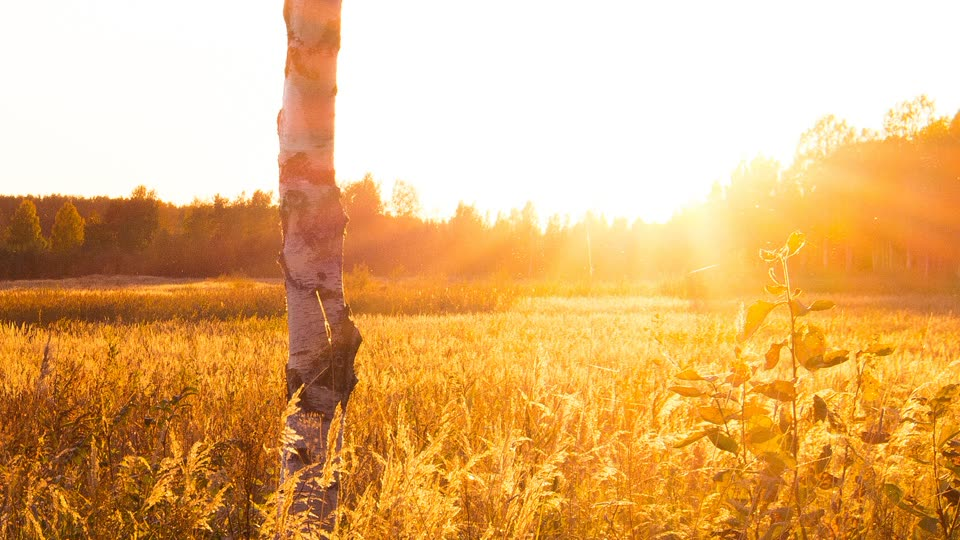  |  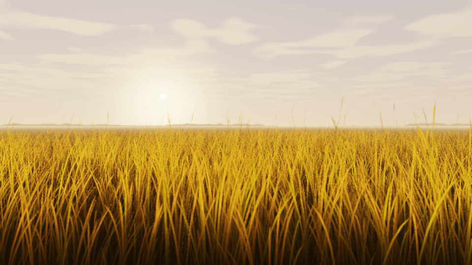  | `meadow`, golden hour, `dry` grass (closer in colour than the meadow grass or tussock)    | **The light, above all.** The photograph is flooded: the sun blows out, warm veiling glare and haze fill the frame, the grass glows gold. The render's backlight is right in kind and far too tame. And the grass: the photograph's is mostly feathery seed panicles; the render's is blades. |
| 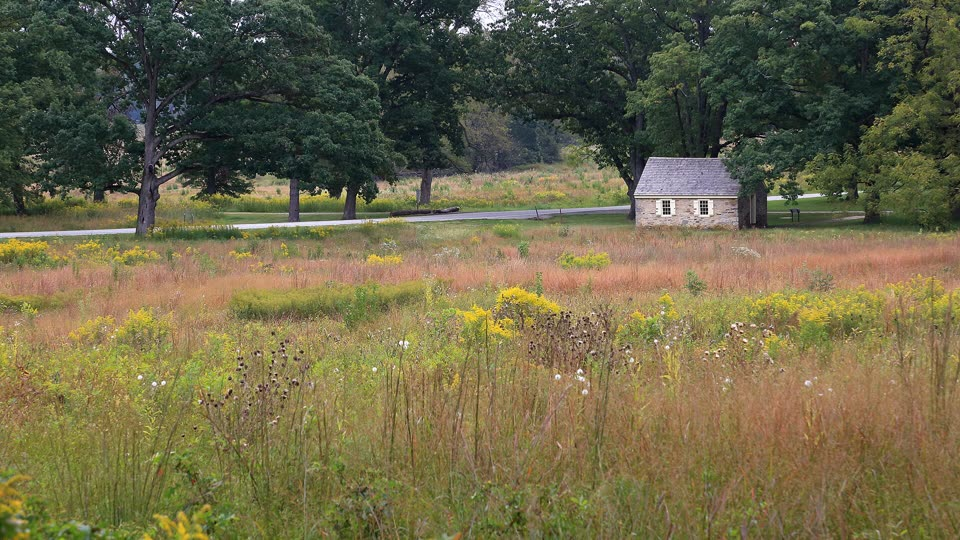 | 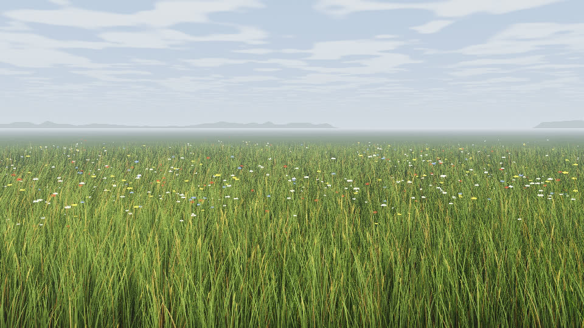 | `meadow`, midday, wildflowers at 1                                                        | **One species.** A real meadow is a mix: pink-red seed heads, clumps of goldenrod, forbs gone to seed, all at different heights. The render is one green grass with flowers as dots. Then the context: trees, a house, a road.                                                                |
|   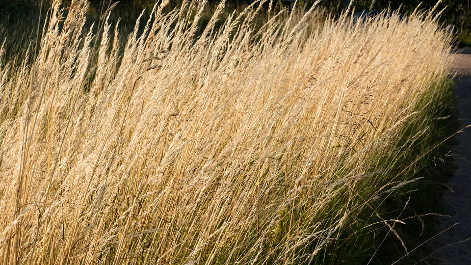   |   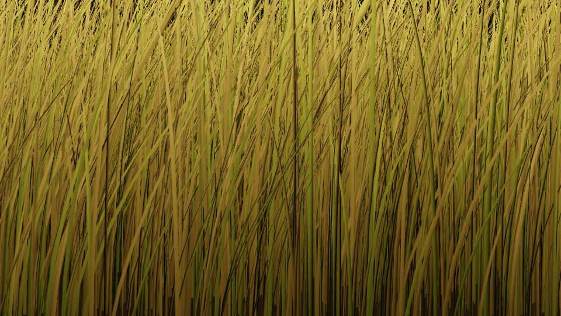   | `grass-footer`, `dry` grass, strip height 0.9, blades 1.4 times as tall, over a dark page | **The seed heads.** Most of what the photograph shows is fine, feathery panicles in warm straw; the render's heads are a single spindle each, and its blades read olive beside the photograph's gold.                                                                                         |
|   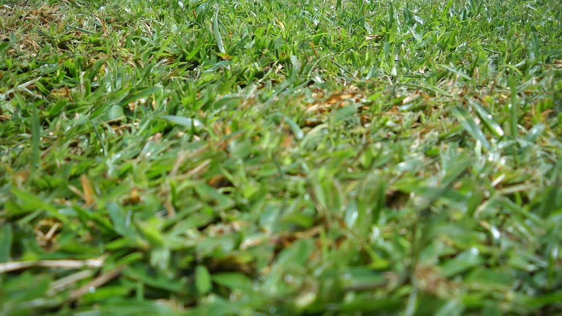    |   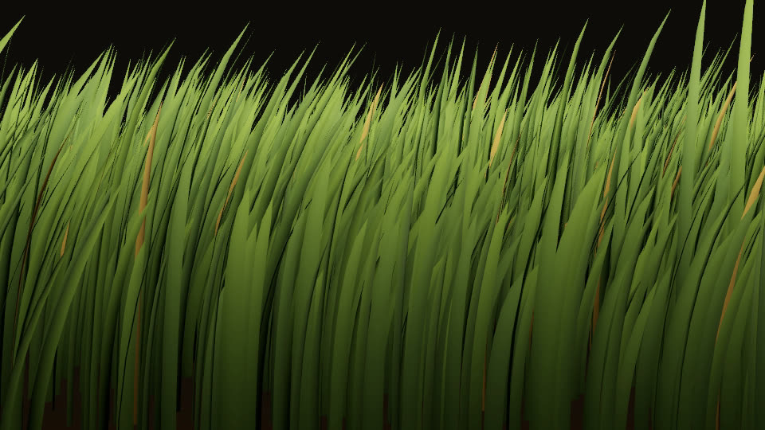    | `grass-footer`, `lawn`, strip height 0.9, over a dark page                                | **The angle and the blades.** The photograph's broad blades lie every way in a close, shallow-focus view with no sky; the render's stand upright in a strip.                                                                                                                                  |
| 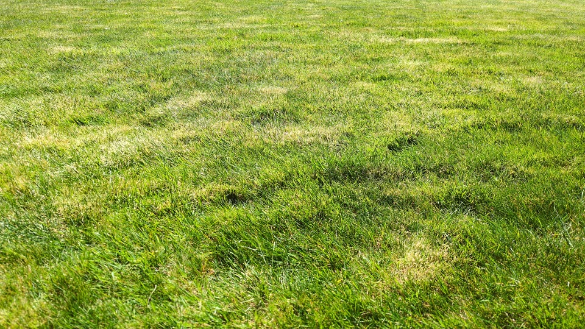 | 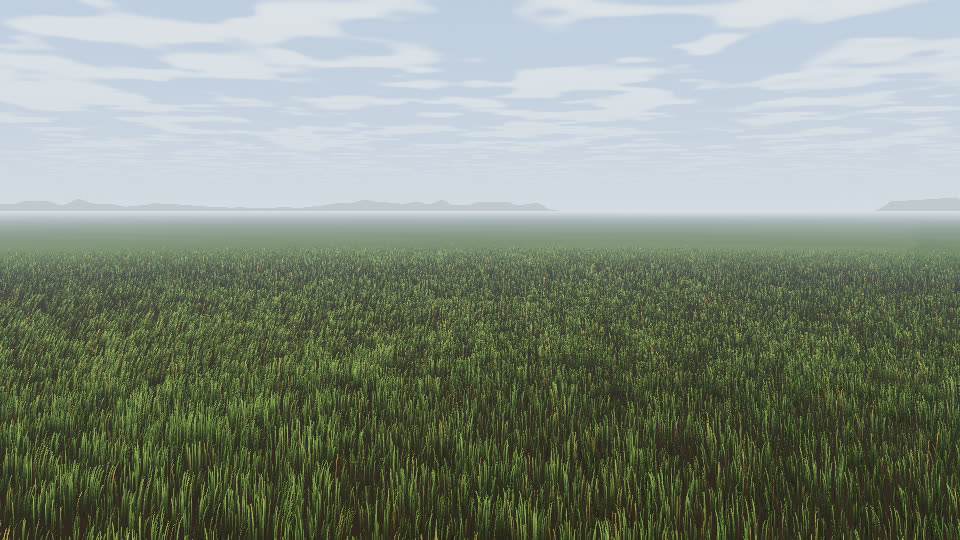 | `meadow`, midday, `lawn` grass, no flowers                                                | **The camera.** The photograph looks down at sunlit tips; the meadow's camera is level, and sees a dark, low-contrast carpet. A lawn needs the lawn effect's tilted camera (story 3.3).                                                                                                       |

**What the photographs say the engine lacks**, roughly in order of how much it would buy:

1. **Mixed species.** Several grasses and forbs at once, each with its own height, colour and seed head, and their own patches. The species table already exists; a field drawn from several at once is the next step.
2. **Seed panicles.** Feathery, branching inflorescences, which dominate a mature or dry field. A spindle per stem stands for all of them now.
3. **Backlit light in the air.** Veiling glare and warm haze around a low sun, and lens flare: the photograph's exposure is half of its golden hour.
4. **Views from above**, for lawns: story 3.3's tilted camera.
5. **Context**: trees, hedges and buildings; the hedge on the horizon is a start.

**Blind pairs.** [blind.html](realism/blind.html) asks two things, sides hidden: for each photograph, which of the pair is the photograph; and for the eleven subtle parts the ablation could not tell apart by eye, which of the full recipe and the frame without the part looks more real. Open it with the dev server running: `http://localhost:5490/docs/studies/realism/blind.html`. The judgement is the user's, and is not recorded here yet.

## The full recipe

|                    Midday                    |                      Golden hour                       |
| :------------------------------------------: | :----------------------------------------------------: |
| 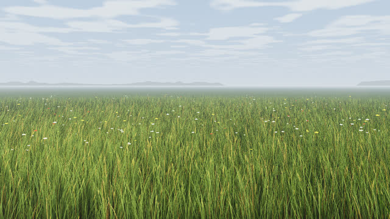 |  |

## Without each part

Costs are what the frame saves without the part, against the full recipe's 2.10 ms (midday) or 3.36 ms (golden hour). "Free" means no difference the study can resolve: those parts are a few shading terms or a random choice per blade.

| Without                 | Saves                                      | What the picture loses                                                                                                                                                        | Midday                                 | Golden hour                                 |
| ----------------------- | ------------------------------------------ | ----------------------------------------------------------------------------------------------------------------------------------------------------------------------------- | -------------------------------------- | ------------------------------------------- |
| Translucency            | free                                       | **Golden hour's glow, all of it.** Seen against the sun, every blade is lit only by light through it: without that, the field is dark silhouettes. At midday, a little depth. | 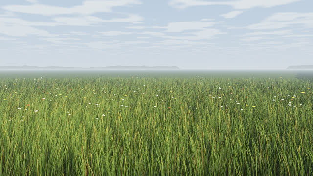   | 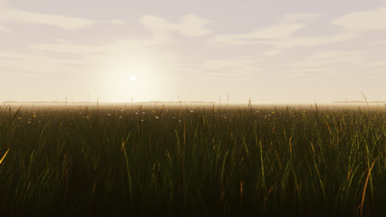   |
| Canopy occlusion        | free                                       | **Depth.** Without the darkening down into the canopy, roots are as bright as tips, and the field is a flat, bright texture in both lights.                                   | 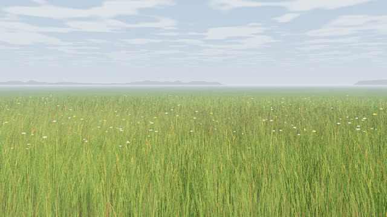         | 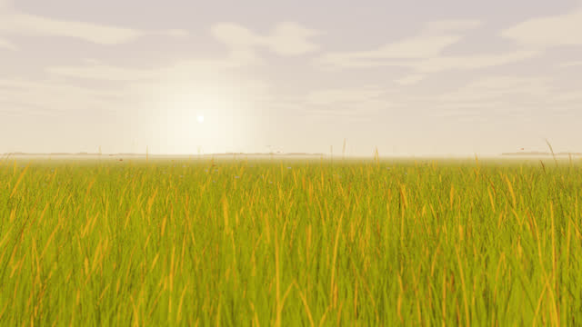         |
| Aerial perspective      | 0.05 ms                                    | **The horizon.** Without haze, the far canopy is a saturated dark band along the horizon and the field ends like a wall.                                                      | 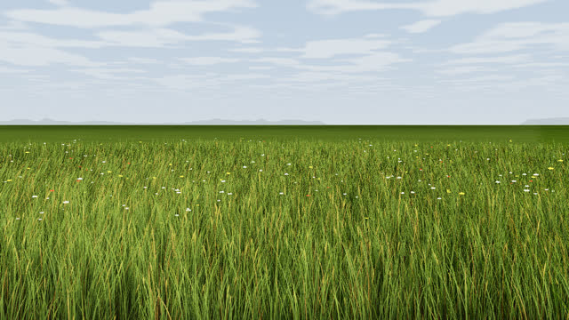            | 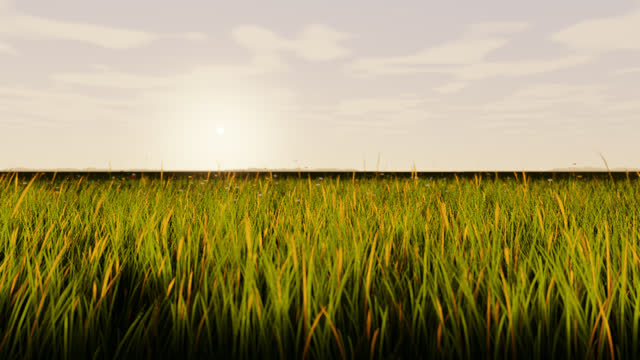            |
| Clouds and their shadow | 0.59 ms                                    | Moving light: the patches of shadow crossing the field, and the sky that casts them. Without, the sky is plain and the field evenly lit.                                      | 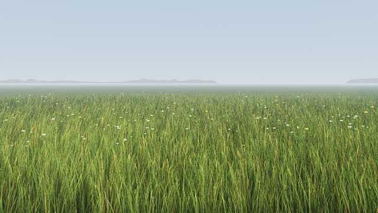         | 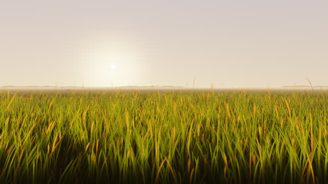         |
| Multisampling           | 0.61 ms (0.54 at golden hour)              | A still shows speckled, stair-stepped blades. In motion it is shimmer: see [grass-safety.md](grass-safety.md).                                                                | 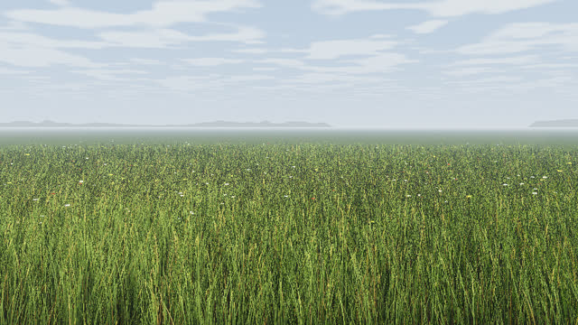      | 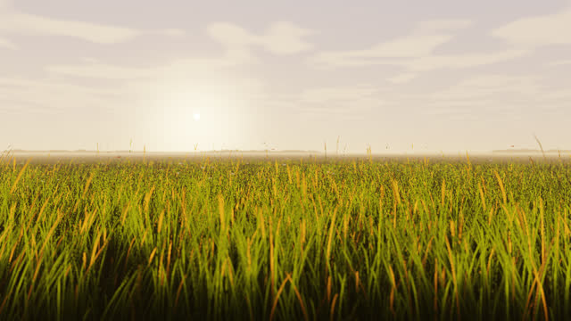      |
| Depth of field          | 1.42 ms at golden hour (skipped at midday) | The photograph's look, and the near blades' softness. It is also safety: in a view among the blades, the sharp near ones shimmered over seven times the limit (story 2.7).    |  | 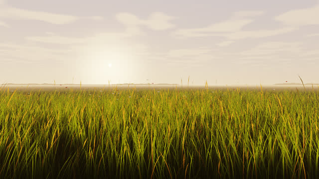 |
| Sheen                   | 0.20 ms                                    | A little sparkle along lit blades. Small in a still; in motion, it shows the gusts' waves.                                                                                    |           | 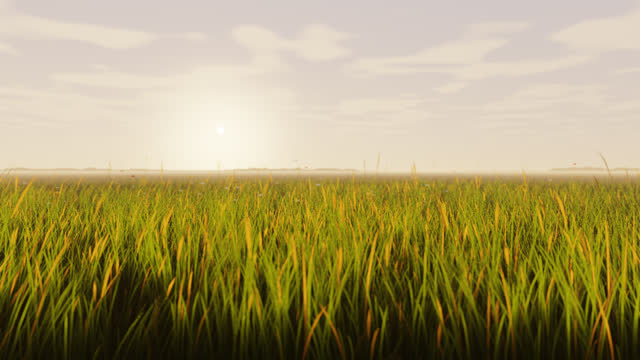          |
| Clumps                  | 0.11 ms                                    | Small: the field is a little more even, its tufts less distinct close up.                                                                                                     | 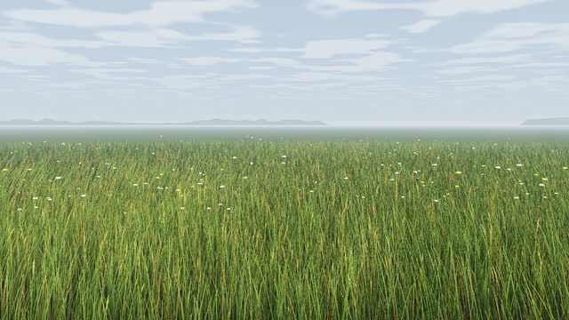         | 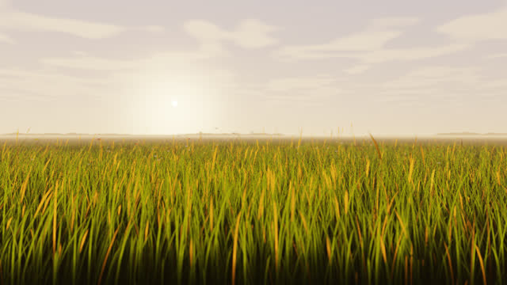         |
| Colour variation        | free                                       | Small: every blade the same green, read only up close.                                                                                                                        | 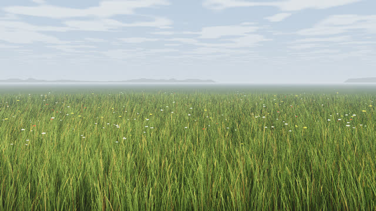      | 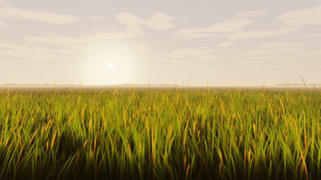      |
| Dry blades              | free                                       | Small: the straw-coloured strands that break up the green.                                                                                                                    | 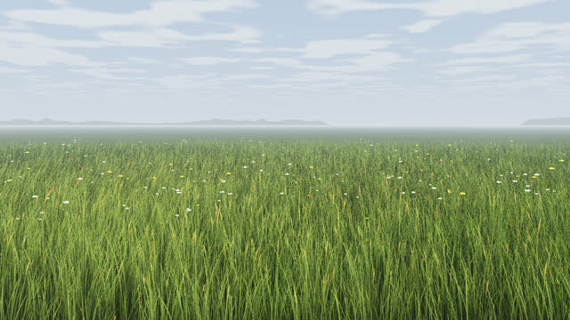            | 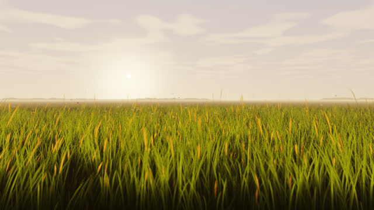            |
| Rounded normals         | free                                       | Very small at this distance: blades shade flat.                                                                                                                               | 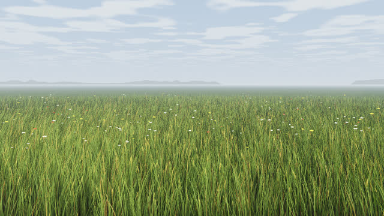        | 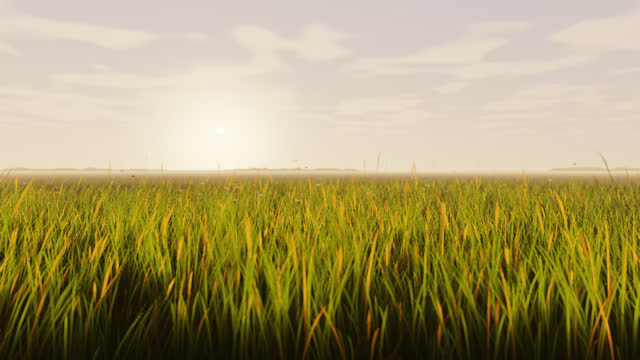        |
| Gusts                   | free                                       | Nothing in a still. In motion, the waves crossing the field.                                                                                                                  | 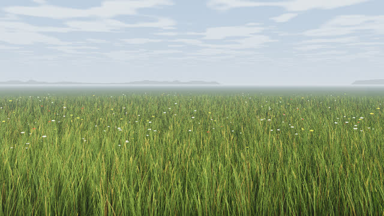          | 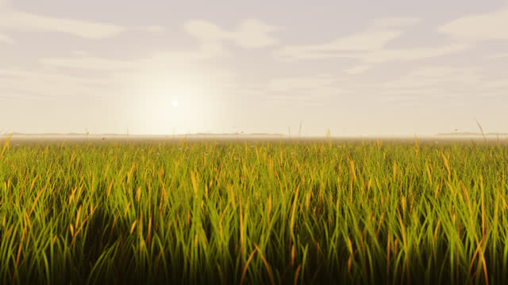          |
| Wildflowers             | about 0.1 ms                               | Colour scattered in drifts. The field without it is all grass, which is also real.                                                                                            | 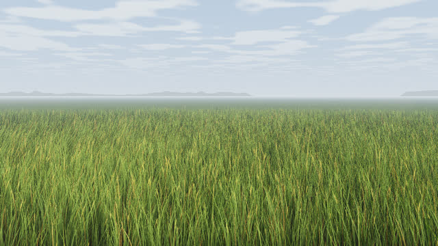        | 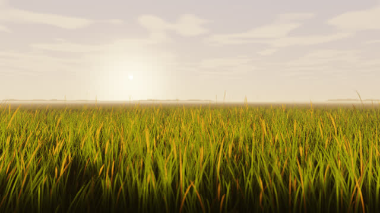        |

**What the ablation found that was wrong.** In its first run, switching translucency off barely changed golden hour. That was a bug, not a finding: the blade's normal was taken from the triangle's winding, which pointed it away from the viewer, so a backlit blade was lit by reflection, never through it. With the normal chosen for the viewer once per blade, the glow appeared, and translucency became golden hour's largest part. An ablation is a test as well as a study.

## Shells (story 2.8)

Shells drawn beyond the blades' full detail cost 0.19 ms more and change nothing a viewer can see at eye level: the slices are seen nearly edge-on, and the canopy ground already covers that distance. They are built for views from above. That judgement waits for the lawn (story 3.3), whose camera looks down.

## The cheapest recipe that still reads as real

In order of what is lost without them: **translucency** and **canopy occlusion** (both free), **aerial perspective** (nearly free), then **clouds** (0.6 ms) and **multisampling** (0.6 ms, and needed for safety). Sheen, clumps, variation, dry blades and rounded normals each add a little and cost little; together they are what stops the field reading as one repeated texture up close. Depth of field is worth its 1.4 ms only where something is near enough to blur.

- **Tier A** (2 ms in Chrome): a strip, as `grass-footer` draws it: leaf optics, translucency, canopy occlusion, gusts and multisampling, with no sky, no clouds and no depth of field. It reads 2.07 ms in Chrome, just over the budget, so even this is Tier B on this machine; a lower density fits.
- **Tier B** (6 ms): the meadow at about half density (density 0.5 read 4.8 ms in Chrome; the `sparse` preset is 0.45), full recipe, depth of field only where it blurs by 2 px or more.
- **Tier C**: the meadow at full density, 6.2 ms in Chrome at midday, 7.7 at golden hour.
